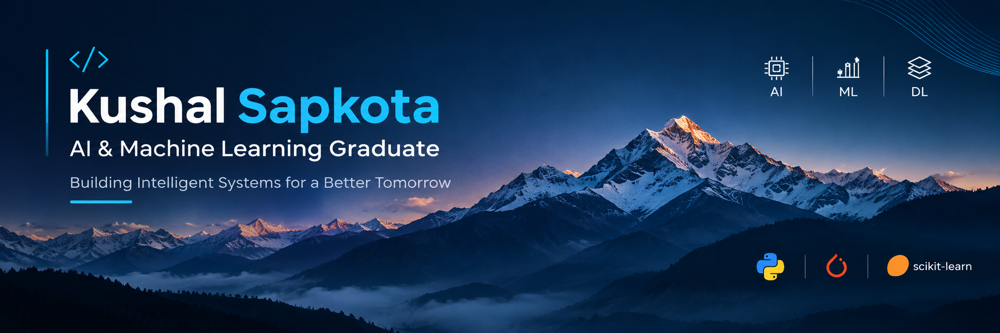

  

---
<h1 align="center">Hi 👋, I'm Kushal Sapkota</h1>

<h3 align="center">
  AI & Machine Learning Graduate
</h3>

  Passionate about Machine Learning, Deep Learning,
  and building intelligent systems.

---

## 👨‍💻 About Me

- 🎓 B.E. graduate in Artificial Intelligence and Machine Learning.
- 🤖 Interested in Machine Learning, Deep Learning, and AI Engineering.
- 💻 Primarily working with Python and its ML ecosystem.
- 🔬 Experienced in developing machine learning and deep learning projects.
- 🌱 Currently strengthening my knowledge of ML Systems, MLOps, and Generative AI.
- 🎯 Aspiring to become a Machine Learning Engineer and build scalable intelligent systems.

---

## 🛠️ Tech Stack

### Languages

  

### Machine Learning & Deep Learning

  

### Development Tools

  

### Data Libraries

`NumPy` · `Pandas` · `Matplotlib` · `Seaborn`

---

## 🧠 Areas of Interest

- Machine Learning & Deep Learning
- Natural Language Processing (NLP)
- Generative AI & Large Language Models
- Computer Vision
- Machine Learning Systems
- MLOps & AI Infrastructure

---

## 📚 Currently Learning

- Advanced Machine Learning
- Deep Learning Architectures
- Large Language Models (LLMs)
- Model Deployment and Production ML
- Software Engineering for AI Systems

---

## 🚀 Featured Projects

| Project | Domain |
|---|---|
| Student Price Prediction | Machine Learning |
| AI-Powered Meeting Summarizer | NLP / Generative AI |
| Deepfake Image Detection | Deep Learning / Computer Vision |

*Project repositories and detailed documentation are coming soon.*

---

## 🤝 Connect With Me

  

I'm always interested in connecting with people working in AI, Machine Learning, and technology.

